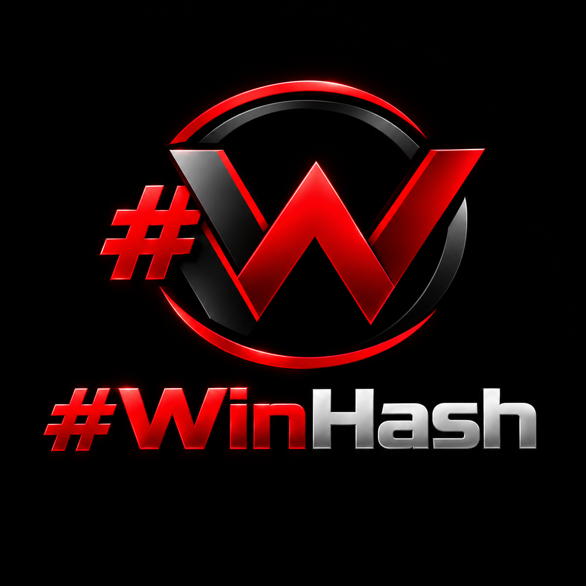
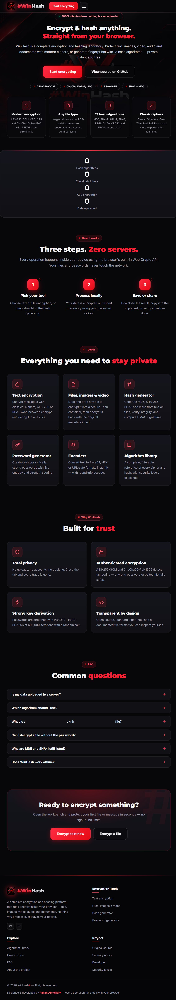
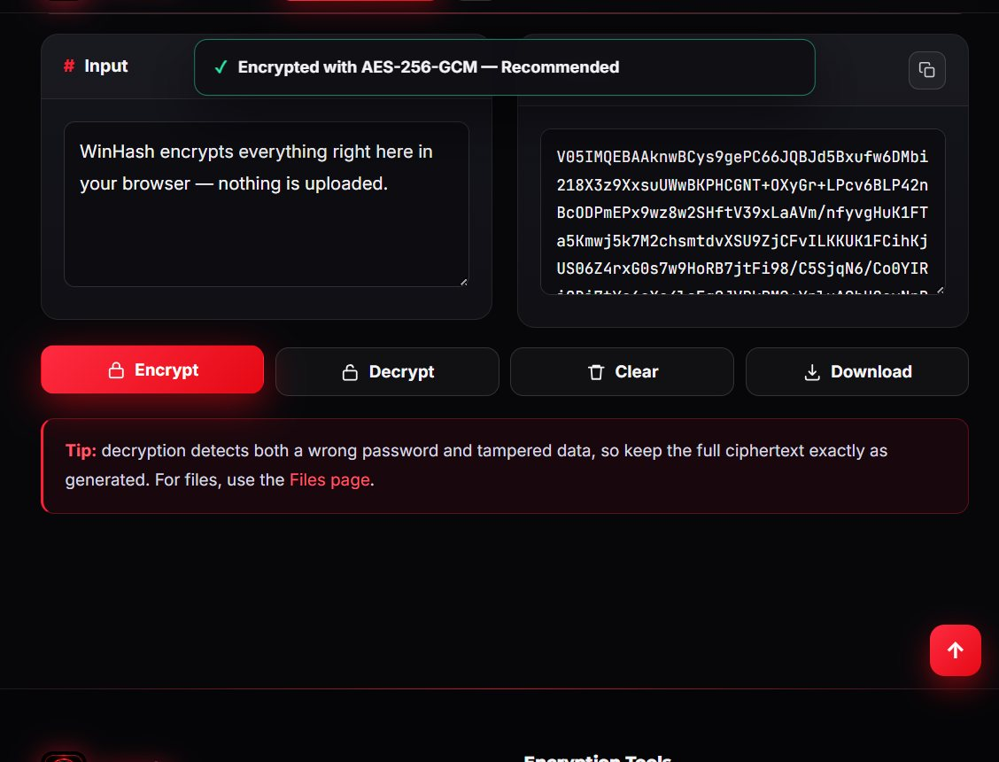
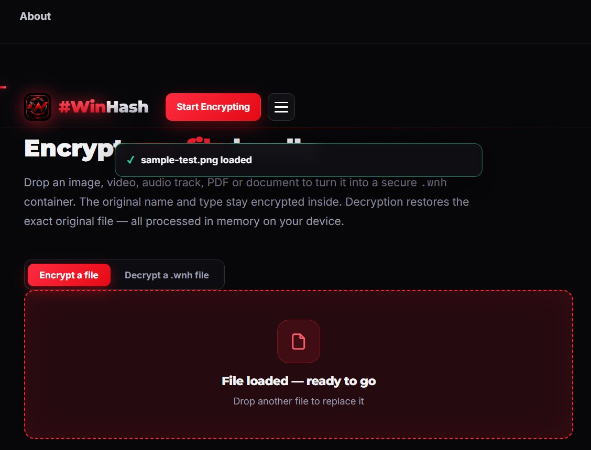
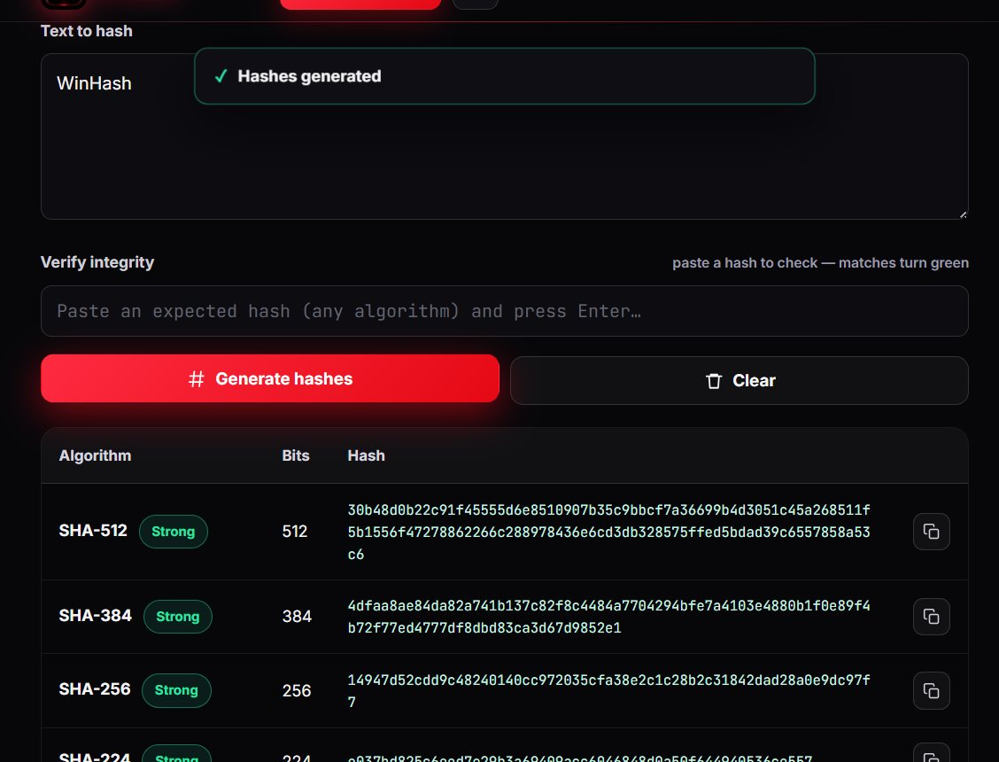
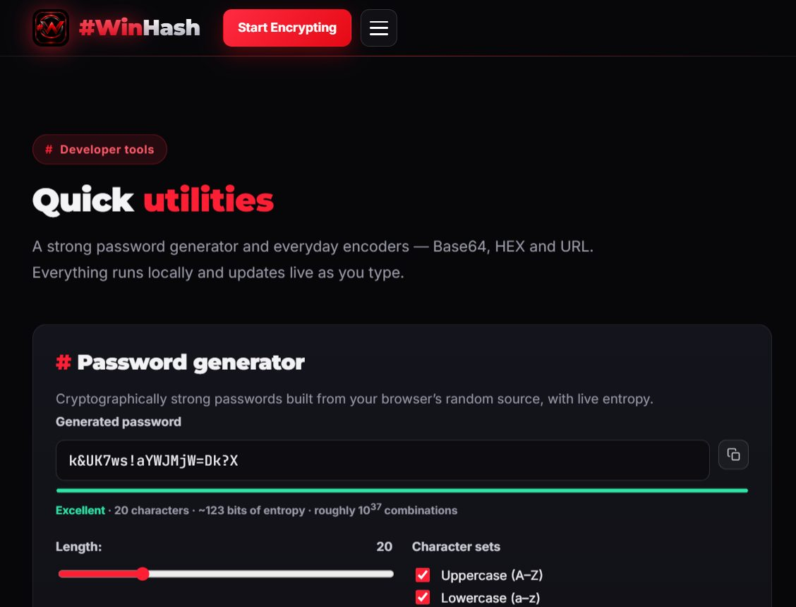
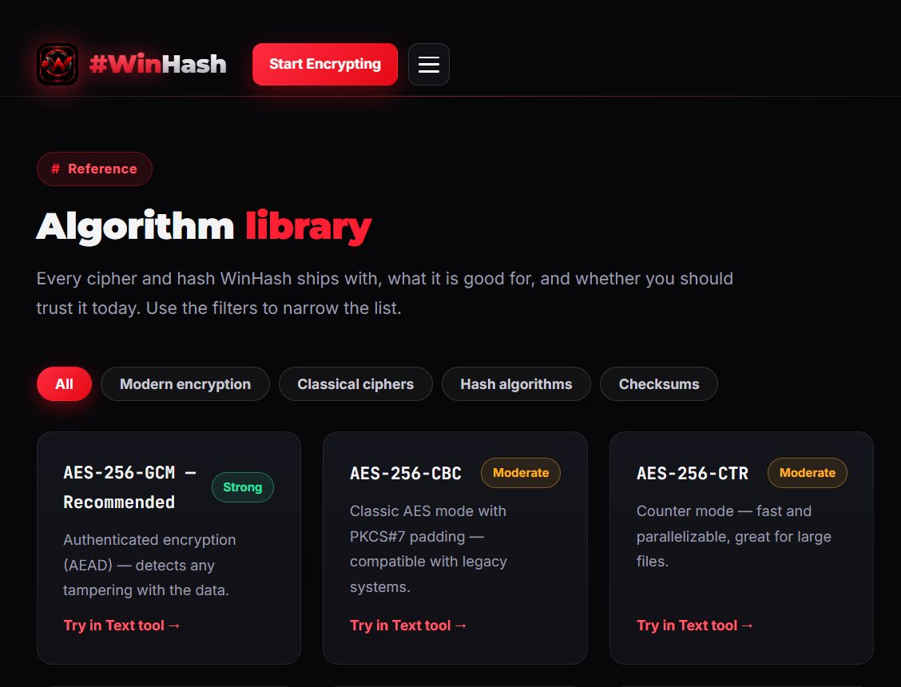
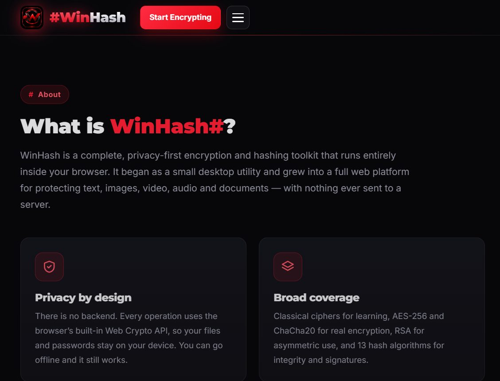

<div align="center">



# WinHash#

### A complete, privacy-first encryption &amp; hashing toolkit — running 100% inside your browser.

**Encrypt text · images · video · documents** — or generate hashes with 13 algorithms.
No uploads. No accounts. No servers. Everything is computed locally with the Web Crypto API.

[Get Started](#-live-demo) · [Encrypt Text](text.html) · [Encrypt Files](files.html) · [Hash Generator](hash.html) · [Algorithm Library](algorithms.html)

</div>

---

<p align="center">
  
  
  
  
  
  
</p>

<p align="center">
  <a href="https://github.com/451646464/encrption_interface"></a>
  <a href="#-license"></a>
  <a href="mailto:rakanalmoliki33@gmail.com"></a>
</p>

---

## Table of Contents

- [Overview](#-overview)
- [Screenshots](#-screenshots)
- [Features](#-features)
- [Supported Algorithms](#-supported-algorithms)
- [How It Works — Security Architecture](#-how-it-works--security-architecture)
- [The `.wnh` Container Format](#-the-wnh-container-format)
- [Pages](#-pages)
- [Project Structure](#-project-structure)
- [Running Locally](#-running-locally)
- [Testing](#-testing)
- [Browser Support](#-browser-support)
- [Security Notice](#-security-notice)
- [Roadmap](#-roadmap)
- [Developer](#-developer)
- [License](#-license)

---

## Overview

**WinHash#** is a full-stack-feeling, single-page-per-tool web application for everyday cryptography. It was rebuilt from the ground up as a **static website** (plain HTML, CSS and JavaScript — no frameworks, no build step, no backend) so that it can be opened from a local file, a USB stick, or any static host, and still work completely offline.

Every operation runs through the browser's built-in **Web Crypto API**, the same cryptographic library used for TLS and secure cookies. Your plaintext, files and passwords **never leave your device** — there is nothing to upload, intercept, or leak.

| | |
|---|---|
| **100% client-side** | No server, no API calls, no telemetry. Disconnect from the internet and it still works. |
| **Modern ciphers** | AES-256-GCM (authenticated), AES-256-CBC/CTR, ChaCha20-Poly1305, RSA-OAEP 2048/4096. |
| **13 hash algorithms** | SHA-2, SHA3, RIPEMD-160, MD5, CRC32, FNV-1a — including incremental/streaming hashing for large files. |
| **13 classical ciphers** | Caesar, Vigenère, Autokey, One-Time Pad, Columnar, Rail Fence, XOR, WinHash Hybrid &amp; more. |
| **Any file type** | Images, video, audio, PDFs and documents are packed into a self-describing `.wnh` container. |
| **Zero dependencies** | No npm, no CDN, no frameworks. Just open it and go. |

---

## Screenshots

<div align="center">

### Home



<br><br>

### Text Encryption — AES-256 workbench



<br><br>

### File Encryption — drag &amp; drop any file



<br><br>

### Hash Generator — all 13 algorithms at once



<br><br>

### Developer Tools — password generator &amp; encoders



<br><br>

### Algorithm Library — filterable reference



<br><br>

### About &amp; Security Notice



</div>

---

## Features

### Text Encryption
- **Classical ciphers** — Caesar, Vigenère, Autokey, One-Time Pad, Columnar (with &amp; without key), Rail Fence, Reverse, Atbash, ROT13, XOR, Base64 and the custom **WinHash Hybrid** (Vigenère → columnar transposition).
- **Modern symmetric encryption** — AES-256 in GCM (authenticated), CBC and CTR modes, plus ChaCha20-Poly1305 where the browser supports it.
- **Asymmetric encryption** — RSA-OAEP with 2048 or 4096-bit keys. Generate a key pair, export PEM, encrypt to a recipient's public key, decrypt with your private key. Long messages are transparently chunked to the key size.
- Live password-strength meter (entropy estimate), show/hide toggles, one-click copy, swap-result-to-input, and `.txt` download.

### File Encryption
- **Drag-and-drop** any file (images, video, audio, PDF, documents) into a secure `.wnh` container.
- The original **filename, MIME type and size stay encrypted** inside the container — nothing leaks in the clear except the file size.
- Decrypting **restores the exact original file** and even shows an inline preview for images, video and audio.
- Choose cipher strength (Fast / Balanced / Strong) and generate a strong password with one click.

### Hash Generator
- **From text** — compute all 13 algorithms in one table with copy buttons.
- **From files** — incremental, chunked hashing (1 MiB chunks) with a live progress bar, so multi-gigabyte files stream through without freezing the UI.
- **Integrity verification** — paste any hash and matching rows light up green.
- **HMAC signatures** — HMAC-SHA-1 / SHA-256 / SHA-512 with a secret key.

### Developer Tools
- **Password generator** — cryptographically strong passwords (6–64 chars) with selectable character sets and live entropy scoring.
- **Encoders** — Base64, Hexadecimal and URL encoding with round-trip decode.

### Experience
- Fully **responsive** (mobile burger nav, fluid grids) with a red/black design system.
- Dark theme, scroll-reveal animations, animated counters, FAQ accordion, toast notifications.
- Runs from `file://` **or** `http(s)://` — no server required.

---

## Supported Algorithms

### Modern Encryption

| Algorithm | Type | Authenticated | Notes |
|---|---|---|---|
| **AES-256-GCM** | Symmetric | ✅ Yes | **Recommended.** Detects any tampering with the data. |
| AES-256-CBC | Symmetric | ❌ No | PKCS#7 padding, compatible with legacy systems. |
| AES-256-CTR | Symmetric | ❌ No | Counter mode — fast &amp; parallelizable, ideal for large files. |
| ChaCha20-Poly1305 | Symmetric | ✅ Yes | Modern high-performance AEAD (shown only if the browser supports it). |
| RSA-OAEP (2048/4096) | Asymmetric | ✅ Yes | SHA-256 based. For key exchange &amp; small messages. |

### Hash Algorithms (13)

| Algorithm | Bits | Category | Security |
|---|---|---|---|
| SHA-512 | 512 | Modern | Strong |
| SHA-384 | 384 | Modern | Strong |
| SHA-256 | 256 | Modern | Strong |
| SHA-224 | 224 | Modern | Strong |
| SHA3-512 | 512 | Modern (Keccak) | Strong |
| SHA3-384 | 384 | Modern (Keccak) | Strong |
| SHA3-256 | 256 | Modern (Keccak) | Strong |
| SHA3-224 | 224 | Modern (Keccak) | Strong |
| RIPEMD-160 | 160 | Legacy | Moderate (used in Bitcoin) |
| SHA-1 | 160 | Legacy | Weak — **broken**, non-security use only |
| MD5 | 128 | Broken | **Broken** — non-security use only |
| CRC32 | 32 | Checksum | Error detection, not encryption |
| FNV-1a (32) | 32 | Checksum | Fast non-cryptographic checksum |

*SHA-1, SHA-256/384/512 and all HMACs use the native Web Crypto implementation. MD5, SHA-224, SHA3-*, RIPEMD-160, CRC32 and FNV-1a are implemented in pure JavaScript and are covered by the test vectors.*

### Classical Ciphers (13)

Caesar · Vigenère · Autokey · One-Time Pad · Columnar Transposition · Columnar (no key) · Rail Fence · Reverse · Atbash · ROT13 · XOR · Base64 · WinHash Hybrid

> ⚠️ Classical ciphers are included for **education and puzzles only**. They are not secure for protecting real data.

---

## How It Works — Security Architecture

```
┌─────────────────────────────────────────────────────────────────┐
│                        YOUR PASSWORD                            │
└──────────────────────────────┬──────────────────────────────────┘
                               │
              ┌────────────────▼────────────────┐
              │  PBKDF2-HMAC-SHA256             │
              │  600,000 iterations (default)   │
              │  16-byte random salt            │
              └───────┬────────────────┬────────┘
                      │                │
          ┌───────────▼──────┐  ┌──────▼─────────────┐
          │   DATA KEY (256) │  │  META KEY (256)    │
          └───────────┬──────┘  └──────┬─────────────┘
                      │                │
        ┌─────────────▼──────┐  ┌──────▼──────────────┐
        │  Encrypt the file  │  │ Encrypt filename /  │
        │  with AES-GCM etc. │  │ MIME type / size    │
        └─────────┬──────────┘  └──────┬──────────────┘
                  │                    │
        ┌─────────▼────────────────────▼──────────────┐
        │              WN H 1  CONTAINER              │
        │  magic │ ver │ algo │ iterations │ salt │   │
        │  iv │ encrypted metadata │ encrypted data   │
        └─────────────────────────────────────────────┘
```

**Key points:**

- **Two independent keys** are derived from your password (with different info strings), so the metadata is protected by a separate key from the data.
- **Random 16-byte salt** per encryption defeats rainbow tables.
- **High iteration count** (600,000 by default, adjustable 210k–1.2M) makes offline brute-forcing impractical.
- **Authenticated modes (GCM / ChaCha20-Poly1305)** cryptographically verify integrity — a wrong password or a flipped bit fails *safely* with a clear error instead of producing garbage.
- **Nothing is stored.** Close the tab and every key is gone from memory.

---

## The `.wnh` Container Format

WinHash uses a compact, self-describing binary container so a single file carries everything needed to decrypt it later — without leaking anything in the clear.

```
Offset  Size   Field
──────  ────   ─────────────────────────────────────────────
 0      4      Magic bytes  "WNH1"  (0x57 0x4E 0x48 0x31)
 4      1      Container version (currently 1)
 5      1      Algorithm ID  (1=AES-GCM, 2=CBC, 3=CTR, 4=ChaCha20)
 6      4      PBKDF2 iterations (big-endian uint32)
10      1      Salt length  (always 16)
11     16      Salt
27      1      IV / nonce length
28      N      IV / nonce
 …      2      Encrypted-metadata length (big-endian uint16)
 …      M      Encrypted metadata  (AES-256-GCM with the META key)
 …      …      Encrypted data       (with the DATA key)
```

The metadata is a small JSON object — `{ "n": originalName, "t": mimeType, "s": originalSize, "kind": "file" }` — that is itself encrypted, so **the filename, type and size stay private**. Only the fixed header (algorithm, iterations, salt, IV) is in the clear, which is exactly what a decryptor needs and nothing more.

---

## Pages

| Page | What it does |
|---|---|
| [`index.html`](index.html) | Home — hero, stats, how-it-works, tool grid, FAQ. |
| [`text.html`](text.html) | Text encryption workbench (Classical · AES · RSA tabs). Supports deep links like `?algo=vigenere` or `?algo=aes-gcm`. |
| [`files.html`](files.html) | Drag-and-drop file encryption / decryption with `.wnh` container. |
| [`hash.html`](hash.html) | Hash generator — from text, from files, and HMAC. |
| [`tools.html`](tools.html) | Password generator + Base64 / HEX / URL encoders. |
| [`algorithms.html`](algorithms.html) | Filterable reference of every cipher and hash with security levels. |
| [`about.html`](about.html) | Project story, security notice and developer credits. |

---

## Project Structure

```
WinHash/
├── index.html                 # Home
├── text.html                  # Text encryption (classical / AES / RSA)
├── files.html                 # File encryption & decryption
├── hash.html                  # Hash generator (text / file / HMAC)
├── tools.html                 # Password generator & encoders
├── algorithms.html            # Algorithm library
├── about.html                 # About, security notice, developer
│
├── assets/
│   ├── css/
│   │   └── style.css          # Full design system (red/black, responsive)
│   ├── img/                   # Logo, icon, favicon, hero background
│   │   ├── logo-full.png      # Glossy WinHash# logo
│   │   ├── icon.png           # App icon / favicon source
│   │   ├── hero-bg.webp       # Hero background
│   │   ├── favicon.png  apple-touch-icon.png
│   │   └── icon-192.png  icon-512.png   # PWA icons
│   └── js/
│       ├── utils.js           # UTF-8 / hex / Base64 helpers, download, copy
│       ├── hashes.js          # 13 hash algorithms (pure JS + WebCrypto)
│       ├── classical.js       # 13 classical ciphers
│       ├── modern.js          # AES / ChaCha20 / RSA + .wnh container
│       ├── chrome.js          # Shared header, footer, nav, UI helpers
│       └── pages/             # Per-page controllers
│           ├── home.js  text.js  files.js
│           ├── hash.js  tools.js  algorithms.js
│
├── docs/                      # Screenshots used in this README
│   ├── home.jpg  text-encryption.jpg  file-encryption.jpg
│   ├── hash-generator.jpg  tools.jpg  algorithms.jpg  about.jpg
│
├── tests/                     # Automated crypto test suite
│   ├── tests.html             # Browser test runner
│   ├── tests.js               # 6 test suites
│   ├── gen_vectors.py         # Generates known-answer vectors
│   ├── vectors.js             # 18 inputs × 11 hashlib algos + CRC32 + FNV + HMAC
│   └── serve.py               # Local dev server (no-cache)
│
├── site.webmanifest  robots.txt  sitemap.xml
└── README.md
```

---

## Running Locally

WinHash is a **static site** — there is nothing to compile or install.

### Option 1 — Just open it

Double-click `index.html`. The Web Crypto API works on `file://` in all modern browsers.

### Option 2 — Use the included dev server (recommended)

```bash
python tests/serve.py
# → Serving on http://127.0.0.1:8766
```

Then open <http://127.0.0.1:8766>.

### Option 3 — Any static host

Drop the folder onto GitHub Pages, Netlify, Vercel, Cloudflare Pages or any web server. It is a handful of HTML/CSS/JS files with **zero dependencies**.

> **Tip:** Once loaded, the site works fully offline. You can disconnect from the network (or use "Work offline") and every encryption, decryption and hash still functions.

---

## Testing

WinHash ships with an automated **known-answer test suite** that verifies the cryptographic implementations against reference vectors generated by Python's `hashlib` and `cryptography` libraries.

```bash
python tests/gen_vectors.py     # regenerate vectors.js (optional)
python tests/serve.py           # start the server
# open http://127.0.0.1:8766/tests/tests.html
```

**Current status: 6 / 6 suites passing** (~5 s)

| Suite | What it checks |
|---|---|
| Hash vectors | 18 inputs × 13 algorithms against Python `hashlib` reference digests |
| Incremental hashing | 5 inputs × 9 algos × 4 chunk sizes (streaming correctness) |
| HMAC vectors | HMAC-SHA-1 / SHA-256 / SHA-512 against known-answer vectors |
| Classical ciphers | Round-trips + published known vectors for every cipher |
| Modern containers | AES-GCM / CBC / CTR / ChaCha20 round-trips for text &amp; files, wrong-password rejection |
| RSA-OAEP | 2048-bit key generation + encrypt/decrypt round-trips |

```
✓ hash vectors (18 inputs × 13 algorithms)
✓ incremental chunked hashing (5 inputs × 9 algos × 4 chunk sizes)
✓ HMAC vectors (sha1/sha256/sha512)
✓ classical ciphers round-trips + known vectors
✓ modern AES containers (gcm/cbc/ctr/chacha, text + files)
✓ RSA-OAEP 2048 round-trips
```

---

## Browser Support

| Browser | Status |
|---|---|
| Chrome / Edge 80+ | ✅ Full support (incl. ChaCha20-Poly1305) |
| Firefox 75+ | ✅ Full support (incl. ChaCha20-Poly1305) |
| Safari 13+ | ✅ Full support |
| Opera / Brave / Vivaldi | ✅ Full support |
| Older browsers (no Web Crypto) | ⚠️ Classical ciphers, MD5, SHA-3, RIPEMD, CRC32, FNV-1a still work; AES/RSA/HMAC show a clear message |

ChaCha20-Poly1305 is **feature-detected at runtime** and only offered when the browser actually supports it — the UI never shows an option that would fail.

---

## Security Notice

> **WinHash is provided for education and convenience.** It uses well-known, standard algorithms, but no tool can guarantee absolute security.

- **Classical ciphers** (Caesar, Vigenère, Rail Fence, …) are **educational only** — never use them for real secrets.
- **MD5 and SHA-1 are broken** for security purposes; they are kept only for legacy compatibility and checksums.
- **CRC32 and FNV-1a are checksums**, not encryption — they provide no secrecy.
- If you lose your password or private key, encrypted data **cannot be recovered** — by design.
- The `.wnh` container protects file contents and metadata, but the file **size** is still visible to observers.
- For high-stakes or professional use, consider a formally audited solution and keep passwords/keys in a reputable password manager.

Everything runs locally in your browser using the standard Web Crypto API — the same library that powers TLS. Review the source, run the tests, and verify it yourself.

---

## Roadmap

- [x] Text encryption — classical, AES-256, RSA-OAEP
- [x] File encryption — images, video, audio, documents via `.wnh`
- [x] Hash generator — 13 algorithms, streaming, HMAC
- [x] Developer tools — password generator, encoders
- [x] Algorithm library &amp; security reference
- [x] Automated known-answer test suite
- [ ] Optional Web Worker offloading for very large files
- [ ] Keyfile / two-factor decryption (password + keyfile)
- [ ] Encrypted note vault with local persistence
- [ ] Argon2id key derivation (WASM) alongside PBKDF2

Contributions, bug reports and feature requests are welcome — open an issue or a pull request on [GitHub](https://github.com/451646464/encrption_interface).

---

## Developer

<div align="center">

**WinHash#** was designed &amp; developed by **Rakan Almoliki**.

Built from the ground up as a modern, responsive web application using vanilla JavaScript, the Web Crypto API, hand-crafted HTML5 and CSS3 — no frameworks, no trackers, no cookies.


</div>

- 🐛 **Issues &amp; features:** [github.com/451646464/encrption_interface](https://github.com/451646464/encrption_interface)
- ✉️ **Email:** [rakanalmoliki33@gmail.com](mailto:rakanalmoliki33@gmail.com)

---

## License

This project is released under the **MIT License** — free to use, modify and distribute, with attribution.

```
MIT License

Copyright (c) 2026 Rakan Almoliki

Permission is hereby granted, free of charge, to any person obtaining a copy
of this software and associated documentation files (the "Software"), to deal
in the Software without restriction, including without limitation the rights
to use, copy, modify, merge, publish, distribute, sublicense, and/or sell
copies of the Software, and to permit persons to whom the Software is
furnished to do so, subject to the following conditions:

The above copyright notice and this permission notice shall be included in all
copies or substantial portions of the Software.

THE SOFTWARE IS PROVIDED "AS IS", WITHOUT WARRANTY OF ANY KIND, EXPRESS OR
IMPLIED, INCLUDING BUT NOT LIMITED TO THE WARRANTIES OF MERCHANTABILITY,
FITNESS FOR A PARTICULAR PURPOSE AND NONINFRINGEMENT. IN NO EVENT SHALL THE
AUTHORS OR COPYRIGHT HOLDERS BE LIABLE FOR ANY CLAIM, DAMAGES OR OTHER
LIABILITY, WHETHER IN AN ACTION OF CONTRACT, TORT OR OTHERWISE, ARISING FROM,
OUT OF OR IN CONNECTION WITH THE SOFTWARE OR THE USE OR OTHER DEALINGS IN THE
SOFTWARE.
```

---

<div align="center">

**WinHash#** — *Encrypt anything. Trust nothing. Upload never.*

Made with ❤️ and ☕ by Rakan Almoliki · [GitHub](https://github.com/451646464/encrption_interface)

</div>
